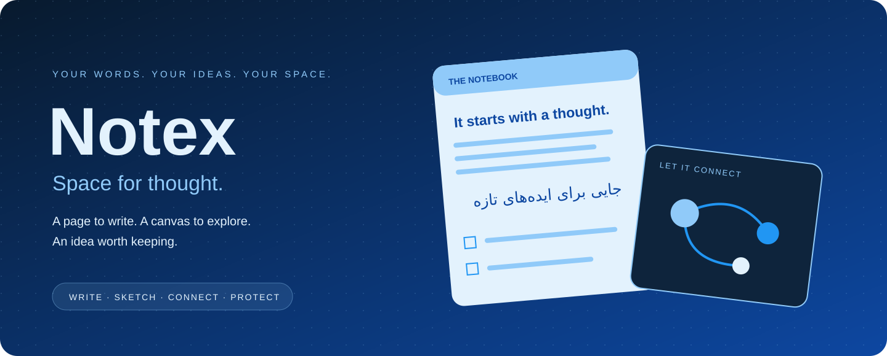
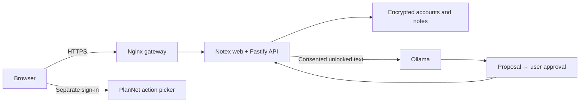

<p align="center">
  
</p>

<h1 align="center">Notex</h1>

<p align="center">
  <strong>Space for thought.</strong><br />
  A calm, self-hostable home for bilingual notes, sketches and the next idea worth keeping.
</p>

<p align="center">
  
  
  
  <a href="LICENSE"></a>
</p>

<p align="center">
  <a href="#one-note-two-ways-to-think">Features</a> · <a href="#quick-start">Quick start</a> ·
  <a href="docs/USING-NOTEX.md">User guide</a> · <a href="docs/DEPLOYMENT.md">Self-hosting</a> ·
  <a href="docs/SECURITY.md">Security</a>
</p>

Notex brings a rich-text page and a wide whiteboard into the same note. Organize ideas into notepads, write naturally in English or Persian, link a PlanNet action, and ask your own Ollama service for help—with approval before changes and a strict boundary around protected notes.

## One note, two ways to think

| Space | What belongs here |
| --- | --- |
| **Write** | Headings, sizes, colors, bold/italic/underline, lists, tables, links and images. |
| **Sketch** | Pen, pencil, marker, highlighter, lines, shapes and text on a large pannable canvas. |
| **Organize** | Notepads, tabs, title search, recently deleted notes and restore. |
| **Connect** | A link to an existing PlanNet action, selected from your own planner. |
| **Protect** | Account access plus an additional passphrase for individual notes. |
| **Ask** | An Ollama-generated proposal that you review, approve or discard. |

### A page that speaks both languages

Automatic paragraph direction lets English and Persian coexist. Force RTL/LTR when needed, choose white, pale-blue or dark paper, and switch the surrounding app between light and dark.

Paste or upload PNG, JPEG, GIF or WebP images up to 2 MB. Image data stays inside the note. Export a note to JSON or import it as a new page.

### Room to draw

- Multiple ink tools, colors, widths, stroke undo/redo and whole-stroke erasing.
- Hand-tool or scroll panning; pinch or Ctrl/Command-scroll zoom.
- Fit the drawing back into view after exploring distant parts of the canvas.
- Written content and saved strokes stay together in one note.

The canvas is large but bounded (coordinates ±100,000), not mathematically infinite. Erasing removes whole strokes near sampled points; it is not pixel erasing.

### Your agent, with boundaries

The optional assistant proposes notes, rewrites, tables, notepad changes, simple strokes and moving notes to trash. **Preparing a proposal does not apply it.**

Locked notes—including their titles and IDs—are excluded from model context even while you have one open. The agent has no password, unlock, account-administration, shell or arbitrary network tools. The backend rechecks locks and revisions before applying an approved proposal.

## Quick start

Use **Node.js 24** and npm. Run these from your Notex checkout:

```sh
npm ci
cp .env.example .env
npm run dev
```

Open **http://127.0.0.1:5180**. One command starts the interface and API; Vite forwards `/api` to `127.0.0.1:8900`.

Create your first owner account or choose **Take a look around** for a read-only sample demo. Development creates an ignored `data/development.key`; keep it with your data.

For the built interface and API together:

```sh
npm run build
npm start
```

Open **http://127.0.0.1:8900**. Add this origin to `NOTEX_ORIGINS` when testing the built app with the development `.env`, so browser writes are accepted.

**Save explicitly.** This release does not autosave.

## How the pieces fit



| Item | Development | Existing Arani Stack |
| --- | --- | --- |
| Website | `http://127.0.0.1:5180` | `https://notex.arani-tech.com` |
| Combined service | `127.0.0.1:8900` | Internal `notex:8900` |
| Health | `http://127.0.0.1:8900/api/health` | `https://notex.arani-tech.com/api/health` |
| Data | `data/` | `Infrastructure/data/notex/` |
| Production secrets | — | `Notex/deploy/.env` |

## Self-hosting

The deployment kit joins the **existing Arani Stack** gateway and `arani-edge` network. The sibling Infrastructure project is required and is not bundled in this repository.

After DNS and the existing gateway are ready:

```sh
cd deploy
sudo bash ./prepare.sh notex.arani-tech.com
sudo nano .env
sudo bash ./start.sh
sudo bash ./register-domain.sh notex.arani-tech.com
```

Read [deployment prerequisites, backup and restore](docs/DEPLOYMENT.md) first. Do not publish port 8900 or replace an existing data key.

<details>
<summary><strong>Configure Ollama</strong></summary>

Set `OLLAMA_BASE_URL` to a trusted endpoint reachable from the API container, `OLLAMA_MODEL` to an installed model name, and optionally `OLLAMA_API_KEY`. Leave the model blank to run without AI.

Notex uses `/api/chat` with non-streaming JSON. It does not require n8n. Never expose an unauthenticated Ollama endpoint publicly.

Context currently includes bounded text from up to 50 unlocked, non-trashed notes—not visual interpretation of drawings or embedded images. Models vary in schema-following ability; review proposals before approval.

</details>

<details>
<summary><strong>Link a PlanNet action</strong></summary>

Use **↗ PlanNet** in the writing toolbar and sign in directly to your PlanNet API. Accounts are separate; Notex saves the selected title and link, not your PlanNet credentials. Add the Notex origin to PlanNet's allowed origins.

A compatible PlanNet deployment is required. Deep links open actions after PlanNet's normal authentication checks.

</details>

## Privacy, locks and backups

- Salted scrypt account passwords and AES-256-GCM encrypted account/workspace files.
- Additional passphrase-derived encryption for protected note bodies.
- Protected titles remain visible in your authenticated list; use neutral titles for sensitive subjects.
- Protected notes close after ten minutes or when the tab is hidden. **Save before switching apps/tabs:** unsaved protected edits are discarded.
- No forgotten-note-passphrase recovery.
- JSON exports are **unencrypted**, including exports of unlocked protected notes.
- Keep the original `NOTEX_DATA_KEY`, encrypted backups and separate backup passphrase safe.

This is **not zero-knowledge encryption against the server operator**. Read the complete [security boundaries](docs/SECURITY.md).

## Current scope

A first **web-only** release, not a Word replacement or native Apple Notes integration. No autosave, offline sync, collaborative editing, MFA or email password recovery. Search matches titles; images are embedded rather than kept in a general file library.

Per account: 500 notes, 50 pads and approximately 40 MB serialized workspace. See [the user guide](docs/USING-NOTEX.md) for document/drawing limits and everyday workflows.

## Development and verification

```sh
node --import tsx --test tests/*.test.ts
npm run build
node scripts/verify-ui.mjs
```

The browser check uses Chrome and temporary data. Set `CHROME_PATH` if necessary. Agent tests mock Ollama; verify your actual model separately.

With the sibling PlanNet project installed and built:

```sh
node --import tsx scripts/verify-plannet.mjs
```

```text
src/                  interface, rich editor, whiteboard and action picker
server/               accounts, encrypted notes, locks and agent boundary
shared/               document and operation validation
public/icons/         SVG, PNG, maskable and Apple touch icons
tests/                security regression tests
scripts/              development and browser checks
deploy/               Docker, gateway, backup and restore
docs/                 user guide, security and deployment
```

Integration/packaging scripts expect the wider Arani Stack layout. Basic local notes/editing runs from this checkout alone.

## License

[MIT License](LICENSE) · Copyright © 2026 MohammadParsa Arani.

Third-party dependencies and external content retain their respective licenses.
