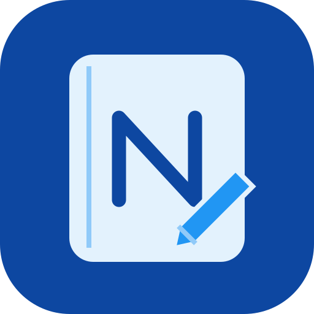

# Notex



**Space for thought.** A bilingual notebook and wide whiteboard for your existing Arani Stack. Web only; blue, light and dark, with its own accounts and password-protected notes.

## Start here

- [Use Notex](docs/USING-NOTEX.md)
- [Update the existing VPS safely](../UPDATES-2026-09-26.md) — includes PlanNet and Portfolio changes, DNS, TLS, Ollama, backups and restore.
- [Security boundaries and storage](docs/SECURITY.md)

## Included

- Notepads and tabs; title search, recently deleted notes and restore.
- English/Persian rich text with automatic paragraph direction, explicit RTL/LTR, headings, sizes, colors, lists, tables, links, pasted/uploaded images and undo/redo.
- White, pale-blue and dark paper independently of the app's light/dark appearance.
- Wide whiteboard with pen, pencil, marker, highlighter, eraser, shapes, lines, text, pan, zoom, fit drawing and stroke undo/redo.
- PlanNet action picker: authenticate directly to PlanNet and insert a link to an existing action.
- Separate account authentication; first-owner setup token in production, owner-created accounts, encrypted storage and per-note passphrases.
- Read-only sample demo; no demo account writes or AI calls.
- Ollama agent: propose note/notepad edits and simple drawing strokes, review the proposal, then explicitly approve it. Locked notes are excluded even while you have them open.
- Original Notex SVG, PNG, maskable and Apple touch icons; home-screen manifest.
- One small web/API service, plus separate encrypted backup and fresh-server restore scripts.

## Local development

Use Node.js 24 LTS (the Docker image uses Node 24).

```sh
cd Notex
npm ci
cp .env.example .env
npm run dev
```

Open `http://127.0.0.1:5180`. The local API runs on `127.0.0.1:8900`; Vite forwards `/api` to it. The first account becomes owner. Development generates `data/development.key`; keep it with the data. Do not expose the development server publicly.

```sh
npm run build
npm start
```

The built app and API are served together at `http://127.0.0.1:8900`. Production requires HTTPS through the gateway, `NOTEX_DATA_KEY`, `NOTEX_SETUP_TOKEN`, and the correct `NOTEX_ORIGINS`.

## Tests

```sh
node --import tsx --test tests/*.test.ts
npm run build
node scripts/verify-ui.mjs
node --import tsx scripts/verify-plannet.mjs
```

The browser tests use temporary data directories and Chrome; set `CHROME_PATH` on systems where Chrome is elsewhere. They check account creation, mixed-language editing, tables, saved ink, note protection and mobile layout. The cross-app test also needs the sibling PlanNet project installed and built; it checks graph filtering/layout and authenticated action links. Agent tests mock Ollama responses: a live configured model is still an installation-time check.

## Scope

This is a first web release, not a Word replacement or a native Apple Notes integration. Save is explicit; there is no autosave, offline sync, collaborative editing, email/password recovery, MFA or native desktop package. Search currently matches note titles. Images are embedded, not a general file library. See the guides for limits and lock behavior.

Code is marked `UNLICENSED`; no public-use license is granted by this release.
